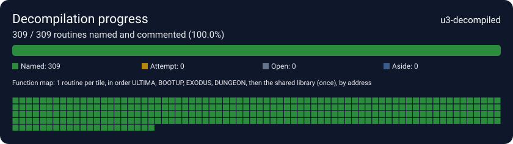

# u3-decompiled

Source code for the PC version of **Ultima III: Exodus** (Origin Systems 1983, PC conversion
by James R. Van Artsdalen), rebuilt with the original tools into files identical to the GOG
release, byte for byte.

## Status



One tile per routine of `src/`, regenerated by `python3 tools/progress.py` (and by a GitHub Action on every push).
The game is hand-written assembly that already rebuilds byte for byte, so, as in u2, the card counts routines with a
C reading in `c/` (a reading aid, not byte-matching; `tools/ccheck.py` checks it against the assembly, see
`c/README.md`); the shared library (`src/LIB.INC`) is counted once. It is not the same measure as the byte-matched C
of u0, u1, u5 or u6.

| file | what | status |
|---|---|---|
| ULTIMA.COM | intro and title animation; loads BOOTUP.BIN over itself | **rebuilds identical** (36692 bytes) from `src/ultima/` |
| BOOTUP.BIN | main menu, party and roster, character creation; loads EXODUS.BIN over itself | **rebuilds identical** (19572 bytes) from `src/bootup/` |
| EXODUS.BIN | the game | **rebuilds identical** (44234 bytes) from `src/exodus/` |
| DUNGEON.DAT | the 3D dungeon view: a code overlay EXODUS loads at 0100 | **rebuilds identical** (1866 bytes) from `src/dungeon/` |

All three link the same library module (screen, text, keyboard, files, sound), one source in
`src/LIB.INC`; EXODUS's slightly different version is two `IFDEF PROG_EXODUS` blocks.

The game is hand-written 8086 assembly. There is no compiler output and no protection envelope.
The sources were generated from the files (`tools/gen.py`, `tools/genlib.py`) and are now
edited by hand. Every address is a symbol, every label has a name and every routine a comment,
so code can be added or removed (`tools/shift.py` proves it), and no instruction is written
as `db`, in modules named for their subsystem. Next: play-test a shifted build (docs/PLAN.md,
docs/HANDOFF.md).

## Toolchain

Assembly: **MASM 4.00** (MASM 3.00 gives the same bytes). Link: Microsoft **LINK 3.05**. The
images are COM programs: LINK writes an EXE whose image starts with the 0100h bytes left free by
`ORG 100h`, and the build keeps the image from 0100 (what EXE2BIN does).

The repository contains neither the game nor the tools. Put the GOG files in `gamedata/`. The
toolchain archives are taken from the sister projects (`../u6-decompiled/tools/masm300/` for the
MASM 3.0 image, `../u1-decompiled/tools/` for the MASM 4.0 archive) or from `tools/`. Then:

```sh
python3 tools/setup.py     # unpacks MASM 3.00/LINK 3.00 and MASM 4.00/LINK 3.05 into build/tc (needs 7-Zip)
python3 tools/build.py     # builds build/{ultima,bootup,exodus}/ and checks each file against GOG's
```

Builds run the DOS tools in headless DOSBox: `dosbox` on the PATH, or the one named by the
`DOSBOX` environment variable; on Windows the GOG copy in `gamedata/DOSBOX/` is used when
neither is set. The analysis tools need `capstone` (on Karl's machine:
`../u1-decompiled/build/venv/Scripts/python.exe`).

## Layout

- `src/TARGET/`: the sources of one file in modules named for their subsystem
  (`docs/MAP.md`), `NAME.lnk` lists them in link order;
  `src/LIB.INC` the shared library, included by each `src/TARGET/LIB.ASM`. MASM needs CRLF line
  ends (.gitattributes keeps them)
- `tools/build.py`: assemble, link, cut the image, compare; `tools/dos.py`: headless DOSBox;
  `tools/setup.py`, `fat12.py`: toolchain
- `tools/u3an.py`: recursive disassembly and per-file facts (entry points, jump tables, data
  areas); `python3 tools/u3an.py` prints coverage and indirect branches
- `tools/gen.py`, `tools/genlib.py`, `tools/regen.py`: generate the program and library sources
  from the files and iterate until they assemble identically (for re-deriving pieces; `src/` is
  the source of truth)
- `tools/u3fmt.py`: readers and PNG renderers for every data file (`docs/FORMATS.md`);
  `u3fmt.py check` parses them all
- `tools/shift.py`: relocation test (pad every module, rebuild, check only addresses moved);
  `tools/play.py`: play a build in DOSBox with GOG's settings; `tools/cands.py`,
  `tools/ptrtabs.py`: surveys for addresses still written as numbers
- `tools/syms.py`, `rename.py`, `lint.py`, `dups.py`: the naming tools (`docs/NAMING.md`)
- `docs/MAP.md`: modules and routines; `docs/FORMATS.md`: data files; `docs/FINDINGS.md`: what the
  code revealed (mechanics, bugs, the protection removal)
- `docs/PLAN.md`: the plan; `docs/HANDOFF.md`: state, findings and next steps
